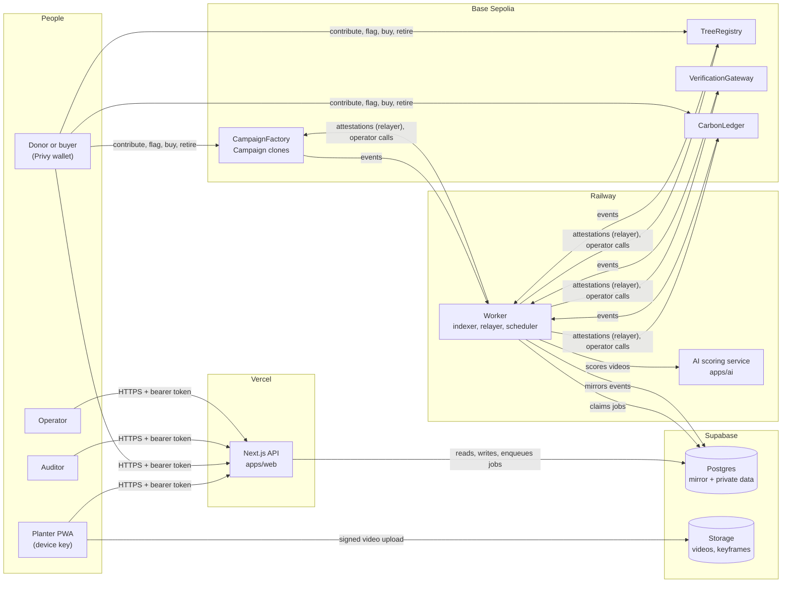

# Treecord

**Every tree, proven.**

Treecord pays communities in Indonesia to keep forests alive and makes every tree provable, so donors trust their impact, verifiers trust the data, and companies trust their carbon.

It has three layers:

1. **Tree campaigns.** Donors fund campaigns in test USDC. Local planters claim tree slots, plant, and are paid for survival, not just planting: six milestone payouts per tree over 36 months.
2. **Digital Monitoring and Reporting (M and R).** Every check-in is a short video recorded in the app and signed by the planter's device key, with GPS and capture time locked in the signature. The backend runs prechecks, an AI service scores the video, and the backend signs an EIP-712 attestation that releases the payout on-chain.
3. **Audit workspace.** Accredited verifiers (LVVs in Indonesia, VVBs for Verra) sample trees with a reproducible random seed, inspect the full evidence trail, issue "prove it now" challenges, and close a hashed report.

Treecord is the M and R layer. Verification is always done by independent accredited bodies, and credits are issued by registries (SRN PPI or Verra). Treecord mirrors registry serials on-chain so every tonne traces back to its trees and has exactly one owner. Planters earn incentives only, never carbon.

The full product, rules and locked decisions are in [`PRODUCT_KNOWLEDGE.md`](PRODUCT_KNOWLEDGE.md).

## Architecture



- **The chain is the source of truth** for money and status. Supabase mirrors it and stores what is private or large: exact GPS, videos, AI results, flag texts, audit trails. Only a precision-7 geohash (about 150 m) goes on-chain.
- **The AI service only scores.** The backend applies the policy thresholds and signs attestations with the attester key.
- **Planters never pay gas.** The operator wallet sends their claims, and the relayer wallet submits their attestations.
- **The worker** indexes contract events into Supabase (2 confirmations, idempotent writes), runs the scoring pipeline, relays attestations in batches, sends operator jobs, and runs scheduled maintenance (forfeits, expired replants, completion).

More detail: [contracts](docs/contracts.md), [database](docs/database.md), [evidence pipeline](docs/evidence-pipeline.md), [worker](docs/worker.md), [API](docs/api.md), [deployment](docs/deploy.md).

## Repository layout

| Path | What it is |
|---|---|
| `apps/web` | Next.js app. API route handlers under `app/api`, PWA UI later |
| `apps/worker` | Node service: event indexer, transaction relayer, scheduler |
| `apps/ai` | AI scoring service (Python, owned by a teammate). Contract in [`AI_SERVICE_INTERFACE.md`](AI_SERVICE_INTERFACE.md) |
| `packages/contracts` | Foundry project: Solidity contracts, tests, deploy scripts |
| `packages/shared` | ABIs, addresses, EIP-712, evidence payload, constants, zod schemas, audit sampling, carbon math |
| `packages/pipeline` | Server-only evidence pipeline used by the API and the worker: AI client, attester, score job |
| `scripts/demo` | Demo seed, lifecycle and reset scripts |
| `supabase` | Migrations, seed data, pgTAP tests |

## Requirements

- Node 24 (see `.nvmrc`) and pnpm 10 (`corepack enable`)
- Foundry (`forge`, `anvil`, `cast`): https://getfoundry.sh
- Docker, for the local Supabase stack (the Supabase CLI comes with `pnpm install`)

## Run locally

This runs the whole system on your machine: anvil for the chain, local Supabase, the worker with the mock AI scorer, and the web app. Every value in `.env.anvil.example` is a public local default.

```sh
pnpm install
cp .env.anvil.example .env
pnpm db:start                                   # Supabase in Docker: applies migrations and species seed
pnpm build
```

Then, each in its own terminal:

```sh
pnpm --filter @treecord/contracts anvil         # 1. local chain, a block every second
pnpm --filter @treecord/contracts deploy:local  # 2. deploy (once per anvil start), same addresses every time
pnpm --filter @treecord/worker dev              # 3. worker: indexer, relayer, scheduler
pnpm --filter @treecord/web dev                 # 4. API on http://localhost:3000
```

Checks: `curl http://localhost:3000/api/campaigns` lists campaigns, and `curl http://localhost:8080/health` shows every worker loop healthy.

anvil keeps its state only while it runs. After restarting it, deploy again, run `pnpm db:reset` so the database does not mirror the old chain, and delete `scripts/demo/.state/31337.json`.

## Run the demo

The demo drives the real API and contracts as seven users: a corporate donor, an individual donor who also buys credits, three planters, an auditor and an operator. The users sign in with wallet signatures, which the API accepts because `.env.anvil.example` sets `DEMO_WALLET_AUTH=true`. Real users sign in with Privy.

```sh
pnpm demo:seed               # wallets, profiles, devices, campaign, funding, claims, 4 planted trees
pnpm demo:lifecycle --fast   # all six milestones, replant, flag, carbon, audit (about 2 minutes)
pnpm demo:reset              # remove the demo rows from Supabase, then seed again
```

`--fast` moves anvil's clock forward to each milestone window. Without it the lifecycle waits in real time: with the local 60 second time unit the six milestones take about 40 minutes. `--until <n>` stops the check-ins after milestone `n`. Both scripts print every transaction and can be stopped and run again: finished steps are skipped.

What happens:

| Step | Who | What it shows |
|---|---|---|
| Seed | Corporate donor | Stores campaign metadata through the API, then calls `CampaignFactory.createCampaign` |
| | Both donors | Approve and `contribute` test USDC. The campaign activates and the fee, seedling and verification buckets go to the treasury |
| | Planters, operator | Gasless claims (`claimSlotsFor`) and an anchor slot assignment, sent by the operator wallet |
| | Planters | Register device keys, record signed PLANTED videos, and get milestone 0 paid through the evidence pipeline |
| Lifecycle | Operator | Sets the pre-certification carbon estimate. Each donor gets a pro-rata reservation |
| | Planters | Milestone check-ins 1 to 5 (ALIVE videos), each paid in USDC in the same transaction that records it |
| | Planter | One tree is reported DEAD, then REPLANTED before its 2-unit deadline, and keeps its schedule |
| | Donor, operator | The individual donor flags a tree (text off-chain, hash on-chain). The operator upholds it and the tree is removed, returning its unpaid incentives to the pool |
| | Operator | Mirrors a registry issuance (1 t, SRN-PPI serials), fills reservations first, and sets the inventory price |
| | Buyer | Buys 0.2 t from inventory, retires credits, and gets a certificate linking serials, campaign and trees |
| | Auditor | Opens a session with a reproducible sample, checks every signature and hash, records findings, closes a hashed report |
| Report | Anyone | The public impact report: survival rate, incentives paid and returned, estimated, issued and retired carbon |

The scripts upload clips from `scripts/demo/videos/`, or generated placeholders when that folder is empty, which only the mock AI accepts. See [its README](scripts/demo/videos/README.md).

To run the same demo on the deployed stack on Base Sepolia, follow [docs/deploy.md](docs/deploy.md#7-run-the-demo-on-base-sepolia).

## Deployed addresses

**Base Sepolia (84532):** not deployed yet. After `deploy:base-sepolia` (see [docs/deploy.md](docs/deploy.md)), fill this table from `packages/contracts/deployments/84532.json`.

| Contract | Address |
|---|---|
| TreecordRoles | not deployed |
| TreeRegistry | not deployed |
| CampaignFactory | not deployed |
| Campaign (implementation) | not deployed |
| VerificationGateway | not deployed |
| CarbonLedger | not deployed |
| USDC (Circle test token) | `0x036CbD53842c5426634e7929541eC2318f3dCF7e` |

**Local anvil (31337):** a fresh anvil always gives the same addresses, listed in `packages/contracts/deployments/31337.json` (for example CampaignFactory `0xDc64a140Aa3E981100a9becA4E685f962f0cF6C9`).

## API overview

All endpoints are Next.js route handlers in `apps/web/app/api`, documented in [docs/api.md](docs/api.md). Bodies are JSON and validated with zod. Every endpoint checks the caller's role. Money is a decimal string of USDC base units. Endpoints that change the chain enqueue a worker job and return 202.

| Area | Endpoints |
|---|---|
| Profile | `GET /api/me`, `POST /api/profile` |
| Campaigns | `POST /api/campaigns/metadata`, `GET /api/campaigns`, `GET /api/campaigns/:address`, `POST /api/campaigns/:address/claims` |
| Planters | `POST /api/devices`, `DELETE /api/devices/:id`, `GET /api/planter/slots`, `GET /api/planter/trees`, `GET /api/planter/challenges` |
| Evidence | `POST /api/evidence/upload-url`, `POST /api/evidence/:id/submit`, `GET /api/evidence/:id` |
| Donors and trees | `GET /api/donor/dashboard`, `GET /api/trees/:treeId`, `POST /api/flags`, `GET /api/reports/campaign/:address` |
| Audit | `POST /api/audit/sessions`, `GET /api/audit/sessions/:id`, evidence bundles, challenges, findings, close, and a public `reproduce` check |
| Carbon | `GET /api/carbon/batches`, `GET /api/carbon/holdings`, `GET /api/carbon/retirements/:id` |
| Operator | anchor assignment, submission review, flag resolution, carbon estimate, issuance and price |
| Jobs | `GET /api/jobs/:id` |

## Tests and checks

```sh
pnpm build && pnpm typecheck && pnpm lint && pnpm format:check
pnpm test                                       # contracts, shared, pipeline, worker, web (route tests need pnpm db:start)
pnpm db:test                                    # pgTAP database rules
pnpm --filter @treecord/worker test:e2e         # worker against a throwaway anvil
cd packages/contracts && forge test             # contracts only
```
