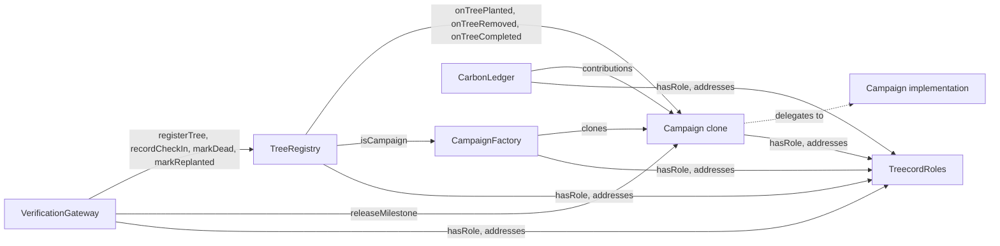

# Treecord contracts

Solidity ^0.8.24, OpenZeppelin v5, Foundry. No upgradeability. Sources live in `packages/contracts/src`.

This file covers the contracts built in prompt 2. VerificationGateway and CarbonLedger are added in prompt 3. Their interfaces already exist in `src/interfaces/` so the rest compiles against them.

## Overview

| Contract | File | Responsibility |
|---|---|---|
| TreecordRoles | `src/TreecordRoles.sol` | Central role registry and address book |
| RoleGated | `src/TreecordRoles.sol` | Abstract base with role and gateway modifiers |
| CampaignFactory | `src/CampaignFactory.sol` | Validates configs, deploys campaign clones |
| Campaign | `src/Campaign.sol` | USDC escrow, slots, milestone incentives, refunds |
| TreeRegistry | `src/TreeRegistry.sol` | Tree identity, health, check-ins, flags |
| TreecordTypes | `src/libraries/TreecordTypes.sol` | Shared enums, structs, custom errors |
| TreecordConstants | `src/libraries/TreecordConstants.sol` | Protocol defaults and the milestone schedule |

## Deployment and wiring

1. `TreecordRoles(admin, treasury)`
2. `TreeRegistry(roles)`
3. `Campaign(roles, usdc, treeRegistry)`: the implementation. Its constructor disables initializers.
4. `CampaignFactory(roles, campaignImplementation)`
5. `roles.setFactory`, `roles.setTreeRegistry`, and later `roles.setGateway` and `roles.setCarbonLedger`. Each component address can be set once.
6. Grant `OPERATOR_ROLE`, `ATTESTER_ROLE` and `ISSUER_ROLE` on TreecordRoles.

## Design decisions

- **One central role registry.** Every campaign is a clone. If each clone inherited its own AccessControl, rotating the operator key would take one transaction per campaign. TreecordRoles is the single place to grant and revoke roles for every contract. The cost is one external view call per role check.
- **Shared immutables in clones.** `roles`, `usdc` and `treeRegistry` are immutables of the Campaign implementation. Immutables live in bytecode, so every clone reads the same values without storing them.
- **Money only moves in Campaign.** TreeRegistry owns tree state and calls back into the campaign. The campaign owns slots and all USDC accounting.
- **Overfunding is never pulled.** `contribute` takes `min(amount, fundingTarget - totalRaised)`.
- **One event per claim.** Slots are handed out sequentially, so a claim is always a contiguous range and is logged once as `(planter, firstSlotId, count)`. That is cheaper than one event per slot.
- **Flags freeze the clock.** While a tree is Flagged, payouts, forfeits and dead-tree expiry revert. On dismissal the flagged duration is added to the tree's `pausedDuration`, which shifts every milestone window, and to the replant deadline if the tree was Dead.
- **Rounding never loses USDC.** Bucket remainders go to the reserve. The per-tree remainder of the incentive pool is `incentiveDust`. The last milestone of each tree pays the per-tree remainder, so the six milestones of a tree sum exactly to `perTreeIncentive`. Everything unpaid at completion is in `refundPool`.
- **Replacement reserve draws.** `drawReserve(treeId, amount)` lets an operator send part of the reserve to the treasury to pay for a replanting. Whatever is not drawn is refunded at completion.
- **Completion floor.** `complete()` measures the commitment period from the later of the last planting and the claim deadline. Without that floor, a campaign with no plantings could complete right after activation.
- **Anchor slots ignore the per-planter cap.** Anchor slots are planted by platform-managed crews. The cap applies only to open claims.

## TreecordRoles

Roles (OpenZeppelin AccessControl):

| Role | Holder | Powers |
|---|---|---|
| `DEFAULT_ADMIN_ROLE` | Deployer | Grants roles, sets treasury, wires components once |
| `OPERATOR_ROLE` | Backend operator wallet | Claims slots for planters, assigns anchor slots, marks trees dead, resolves flags, draws reserve |
| `ATTESTER_ROLE` | Backend attestation signer | Signs EIP-712 attestations checked by the gateway |
| `ISSUER_ROLE` | Backend operator wallet | Mirrors registry issuance in CarbonLedger |

Storage: `treasury`, `factory`, `treeRegistry`, `gateway`, `carbonLedger`. The four component addresses are set-once. The treasury can be updated by the admin.

| Event | When |
|---|---|
| `TreasuryUpdated(previousTreasury, newTreasury)` | Constructor and `setTreasury` |
| `FactorySet(factory)` | `setFactory` |
| `TreeRegistrySet(treeRegistry)` | `setTreeRegistry` |
| `GatewaySet(gateway)` | `setGateway` |
| `CarbonLedgerSet(carbonLedger)` | `setCarbonLedger` |

Plus the standard AccessControl events `RoleGranted`, `RoleRevoked` and `RoleAdminChanged`.

## CampaignFactory

`createCampaign(cfg)` checks that `cfg.creator` is the caller (or that the caller is an operator creating on a donor's behalf), validates the config, deploys a clone with OpenZeppelin `Clones.clone`, records it, and initializes it.

`validateConfig(cfg)` is a public view, so the backend can preflight a config. It reverts when:

| Rule | Error |
|---|---|
| `creator` is zero | `ZeroAddress` |
| Split does not sum to 10000 | `InvalidSplit(sum)` |
| `commitmentUnits < 36` | `CommitmentTooShort(units, 36)` |
| `anchorBps > 10000` | `InvalidAnchorBps(anchorBps)` |
| `fundingDeadline` not in the future, or `claimDeadline < fundingDeadline` | `InvalidDeadlines` |
| `treeTarget == 0` | `InvalidTreeTarget` |
| `timeUnit == 0` | `InvalidTimeUnit` |
| `perPlanterCap == 0` | `InvalidPerPlanterCap` |
| Incentive pool too small for a non-zero per-tree incentive | `InvalidFundingTarget` |

Storage: `implementation` (immutable), `isCampaign` mapping, `_campaigns` array.

| Event | When |
|---|---|
| `CampaignCreated(campaign, creator, config)` | A clone is deployed. `config` is the full `CampaignConfig` |

## Campaign

Status: `Funding`, `Active`, `Refunding`, `Completed`.

### Funding and activation

- `contribute(amount)`: while Funding and before `fundingDeadline`. Pulls at most the remaining amount to the target. Reaching the target activates the campaign in the same transaction.
- On activation, with `F = fundingTarget`:
  - `incentivePool = F * incentivesBps / 10000`
  - seedlings, verification and fee are computed the same way and sent to the treasury
  - `reserveAmount = F - incentivePool - seedlings - verification - fee` (absorbs rounding)
  - `perTreeIncentive = incentivePool / treeTarget`
  - `incentiveDust = incentivePool - perTreeIncentive * treeTarget`
- `markRefunding()`: anyone, after `fundingDeadline` while still Funding.
- `claimRefund()`: the full contribution while Refunding, or `refundPool * contribution / totalRaised` after Completed. Pull pattern, once per contributor.

### Slots

- Ids `1..anchorSlots` are anchor slots. Ids `anchorSlots+1..treeTarget` are open slots. `anchorSlots = treeTarget * anchorBps / 10000`.
- `claimSlotsFor(planter, count)`: operator only, Active, before `claimDeadline`, open slots only, at most `perPlanterCap` open claims per planter.
- `assignAnchorSlots(planter, count)`: operator only, Active. Anchor slots first. After `claimDeadline`, continues with unclaimed open slots. Emits one event per contiguous range (at most two). The per-planter cap does not apply.
- `slotOwner(slotId)`, `slotTree(slotId)`, `availableOpenSlots()`, `availableAnchorSlots()`, `isAnchorSlot(slotId)`.

### Milestones

Schedule (time units after planting, share of `perTreeIncentive`):

| Index | Due | Share |
|---|---|---|
| 0 | 0 | 10% |
| 1 | 3 | 10% |
| 2 | 6 | 10% |
| 3 | 12 | 15% |
| 4 | 24 | 15% |
| 5 | 36 | remainder (40% before rounding) |

- Window: `opensAt = plantedAt + pausedDuration + dueUnits * timeUnit`, `closesAt = opensAt + timeUnit`, both inclusive.
- `releaseMilestone(treeId, milestone, planter)`: gateway only. Tree Alive, planter matches, milestone unsettled, now within the window. Pays the planter in USDC.
- `forfeitMilestone(treeId, milestone)`: anyone, after the window closed. Reverts with `TreeFrozen` while the tree is Flagged.
- `onTreeRemoved(treeId)`: tree registry only. Forfeits every unsettled milestone of the tree.
- Views: `milestoneAmount(m)`, `milestoneWindow(treeId, m)`, `isMilestonePaid(treeId, m)`, `paidMask(treeId)`, `forfeitedMask(treeId)`, `allMilestonesSettled(treeId)`, `unpaidCommittedIncentives()`.

### Completion

`complete()`: anyone, while Active, once `settledCount == plantedCount` (every planted tree Completed or Removed) and `now >= max(lastPlantedAt, claimDeadline) + (commitmentUnits + 1) * timeUnit`. Sets `refundPool = incentivePool + reserveAmount - totalPaid - reserveDrawn`.

### Storage highlights

| Group | Variables |
|---|---|
| Immutables (shared by clones) | `roles`, `usdc`, `treeRegistry` |
| Config | `_config` (`CampaignConfig`), `factory` |
| Funding | `status`, `totalRaised`, `contributions`, `_contributors`, `refundClaimed` |
| Activation | `activatedAt`, `incentivePool`, `reserveAmount`, `perTreeIncentive`, `incentiveDust` |
| Slots | `anchorSlots`, `openSlots`, `anchorAssigned`, `openAssigned`, `slotOwner`, `slotTree`, `openClaimsOf` |
| Trees | `plantedCount`, `settledCount`, `lastPlantedAt`, `paidMask`, `forfeitedMask` (one bit per milestone) |
| Accounting | `totalPaid`, `forfeitedPool`, `reserveDrawn`, `refundPool` |

Accounting identity while Active: `USDC balance = incentivePool + reserveAmount - totalPaid - reserveDrawn`.

### Events

| Event | When |
|---|---|
| `Contributed(contributor, amount, totalRaised)` | A contribution is accepted. `amount` is what was pulled |
| `Activated(activatedAt, incentivePool, perTreeIncentive, reserveAmount)` | Funding target reached |
| `BucketsReleased(treasury, seedlings, verification, fee)` | Buckets sent to the treasury on activation |
| `RefundingStarted()` | `markRefunding` |
| `Refunded(contributor, amount)` | `claimRefund` |
| `SlotsClaimed(planter, firstSlotId, count)` | `claimSlotsFor` |
| `AnchorSlotsAssigned(planter, firstSlotId, count)` | `assignAnchorSlots`, once per contiguous range |
| `SlotPlanted(slotId, treeId, planter)` | A tree is registered for the slot |
| `MilestonePaid(treeId, milestone, planter, amount)` | `releaseMilestone` |
| `MilestoneForfeited(treeId, milestone, amount)` | `forfeitMilestone`, or each unsettled milestone on removal |
| `ReserveDrawn(treeId, to, amount)` | `drawReserve` |
| `CampaignCompleted(refundPool)` | `complete` |

## TreeRegistry

Tree ids are global and sequential from 1. Status: `None` (unknown id), `Alive`, `Flagged`, `Dead`, `Removed`, `Completed`.

| Function | Caller | Effect |
|---|---|---|
| `registerTree(campaign, slotId, planter, geohash, evidenceHash)` | Gateway | Campaign must come from the factory. Mints a tree, then `campaign.onTreePlanted` checks slot ownership and that the slot is not planted |
| `recordCheckIn(treeId, evidenceHash)` | Gateway | Alive only. Increments `checkInCount` |
| `markDead(treeId, evidenceHash)` | Gateway or operator | Alive to Dead. `replantDeadline = now + 2 * timeUnit` |
| `markReplanted(treeId, evidenceHash)` | Gateway | Dead to Alive, before the replant deadline |
| `expireDead(treeId)` | Anyone | Dead to Removed after the replant deadline. Forfeits unpaid incentives |
| `flag(treeId, reasonHash)` | Campaign contributor | Alive or Dead to Flagged. One active flag per tree |
| `resolveFlag(treeId, uphold, noteHash)` | Operator | Uphold: Removed. Dismiss: previous status, schedule shifted by the flagged duration |
| `markCompleted(treeId)` | Anyone | Alive to Completed once every milestone is paid or forfeited |
| `getTree(treeId)`, `statusOf(treeId)`, `treeOfSlot(campaign, slotId)`, `flaggerOf(treeId)` | View | |

### Storage highlights

`Tree` packs into four slots:

| Slot | Fields |
|---|---|
| 0 | `campaign`, `slotId` (uint32), `status`, `statusBeforeFlag` |
| 1 | `planter`, `plantedAt` (uint64), `checkInCount` (uint32) |
| 2 | `geohash` (bytes8), `replantDeadline`, `flaggedAt`, `pausedDuration` (uint64 each) |
| 3 | `latestEvidenceHash` |

Other storage: `treeCount`, `treeOfSlot[campaign][slotId]`, `flaggerOf[treeId]`.

### Events

| Event | When |
|---|---|
| `TreePlanted(treeId, campaign, slotId, planter, geohash, evidenceHash, plantedAt)` | `registerTree` |
| `CheckInRecorded(treeId, evidenceHash, checkInCount)` | `recordCheckIn` |
| `TreeDied(treeId, evidenceHash, replantDeadline)` | `markDead` |
| `TreeReplanted(treeId, evidenceHash)` | `markReplanted` |
| `TreeRemoved(treeId, reason)` | `expireDead` (`ReplantExpired`) or upheld flag (`FlagUpheld`) |
| `TreeFlagged(treeId, flagger, reasonHash)` | `flag` |
| `FlagResolved(treeId, upheld, noteHash, pausedSeconds)` | `resolveFlag`. `pausedSeconds` is zero when upheld |
| `TreeCompleted(treeId)` | `markCompleted` |

## Interfaces for prompt 3

- `IVerificationGateway`: `submit`, `submitBatch`, `hashAttestation`, `nonceUsed`, event `AttestationAccepted(nonce, kind, treeId, evidenceHash, score)`. The `Attestation` struct is in TreecordTypes.
- `ICarbonLedger`: estimate, reservations, issuance, price, buy, retire, and their events. Carbon amounts use 3 decimals (`1000 = 1 tCO2e`), so pro-rata reservations keep kilogram precision while registry batches stay whole tonnes.

## Lint

`forge build` runs forge-lint. The `block-timestamp` lint is disabled in `foundry.toml` because windows and deadlines are time-based by design. Every narrowing cast carries a `forge-lint: disable-next-line(unsafe-typecast)` comment that explains why it is safe.
