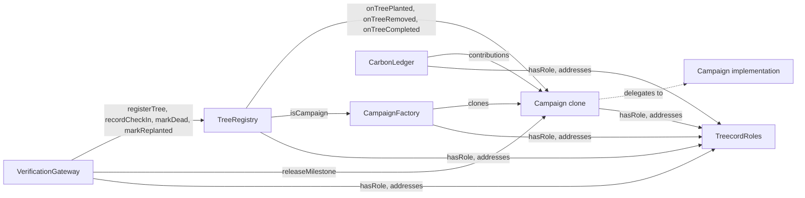

# Treecord contracts

Solidity ^0.8.24, OpenZeppelin v5, Foundry. No upgradeability. Sources live in `packages/contracts/src`.

Every contract implements an interface in `src/interfaces/`. Shared enums, structs and custom errors live in `src/libraries/TreecordTypes.sol`.

## Overview



| Contract | File | Responsibility |
|---|---|---|
| TreecordRoles | `src/TreecordRoles.sol` | Central role registry and address book |
| RoleGated | `src/TreecordRoles.sol` | Abstract base with role and gateway modifiers |
| CampaignFactory | `src/CampaignFactory.sol` | Validates configs, deploys campaign clones |
| Campaign | `src/Campaign.sol` | USDC escrow, slots, milestone incentives, refunds |
| TreeRegistry | `src/TreeRegistry.sol` | Tree identity, health, check-ins, flags |
| VerificationGateway | `src/VerificationGateway.sol` | Verifies EIP-712 attestations and applies them |
| CarbonLedger | `src/CarbonLedger.sol` | Non-transferable ERC-1155 carbon credits: reservations, issuance, sale, retirement |
| TreecordTypes | `src/libraries/TreecordTypes.sol` | Shared enums, structs, custom errors |
| TreecordConstants | `src/libraries/TreecordConstants.sol` | Protocol defaults and the milestone schedule |

## Deployment and wiring

1. `TreecordRoles(admin, treasury)`
2. `TreeRegistry(roles)`
3. `Campaign(roles, usdc, treeRegistry)`: the implementation. Its constructor disables initializers.
4. `CampaignFactory(roles, campaignImplementation)`
5. `VerificationGateway(roles)`
6. `CarbonLedger(roles, usdc, uri)`
7. `roles.setFactory`, `roles.setTreeRegistry`, `roles.setGateway`, `roles.setCarbonLedger`. Each component address can be set once.
8. Grant `OPERATOR_ROLE`, `ATTESTER_ROLE` and `ISSUER_ROLE` on TreecordRoles.

## Design decisions

- **One central role registry.** Every campaign is a clone. If each clone inherited its own AccessControl, rotating the operator key would take one transaction per campaign. TreecordRoles is the single place to grant and revoke roles for every contract. The cost is one external view call per role check.
- **Shared immutables in clones.** `roles`, `usdc` and `treeRegistry` are immutables of the Campaign implementation. Immutables live in bytecode, so every clone reads the same values without storing them.
- **Money only moves in Campaign.** TreeRegistry owns tree state and calls back into the campaign. The campaign owns slots and all USDC accounting.
- **Overfunding is never pulled.** `contribute` takes `min(amount, fundingTarget - totalRaised)`.
- **One event per claim.** Slots are handed out sequentially, so a claim is always a contiguous range and is logged once as `(planter, firstSlotId, count)`. That is cheaper than one event per slot.
- **Flags freeze the clock.** While a tree is Flagged, payouts, forfeits and dead-tree expiry revert. On dismissal the flagged duration is added to the tree's `pausedDuration`, which shifts every milestone window, and to the replant deadline if the tree was Dead.
- **Rounding never loses USDC.** Bucket remainders go to the reserve. The per-tree remainder of the incentive pool is `incentiveDust`. The last milestone of each tree pays the per-tree remainder, so the six milestones of a tree sum exactly to `perTreeIncentive`. Everything unpaid at completion is in `refundPool`.
- **Replacement reserve draws.** `drawReserve(treeId, amount)` lets an operator send part of the reserve to the treasury to pay for a replanting. Whatever is not drawn is refunded at completion.
- **Completion floor.** `complete()` measures the commitment period from the later of the last planting and the claim deadline. Without that floor, a campaign with no plantings could complete right after activation.
- **Anchor slots ignore the per-planter cap.** Anchor slots are planted by platform-managed crews. The cap applies only to open claims.

## TreecordRoles

Roles (OpenZeppelin AccessControl):

| Role | Holder | Powers |
|---|---|---|
| `DEFAULT_ADMIN_ROLE` | Deployer | Grants roles, sets treasury, wires components once |
| `OPERATOR_ROLE` | Backend operator wallet | Claims slots for planters, assigns anchor slots, marks trees dead, resolves flags, draws reserve, sets carbon estimates and prices |
| `ATTESTER_ROLE` | Backend attestation signer | Signs EIP-712 attestations checked by the gateway |
| `ISSUER_ROLE` | Backend operator wallet | Mirrors registry issuance in CarbonLedger |

Storage: `treasury`, `factory`, `treeRegistry`, `gateway`, `carbonLedger`. The four component addresses are set-once. The treasury can be updated by the admin.

| Event | When |
|---|---|
| `TreasuryUpdated(previousTreasury, newTreasury)` | Constructor and `setTreasury` |
| `FactorySet(factory)` | `setFactory` |
| `TreeRegistrySet(treeRegistry)` | `setTreeRegistry` |
| `GatewaySet(gateway)` | `setGateway` |
| `CarbonLedgerSet(carbonLedger)` | `setCarbonLedger` |

Plus the standard AccessControl events `RoleGranted`, `RoleRevoked` and `RoleAdminChanged`.

## CampaignFactory

`createCampaign(cfg)` checks that `cfg.creator` is the caller (or that the caller is an operator creating on a donor's behalf), validates the config, deploys a clone with OpenZeppelin `Clones.clone`, records it, and initializes it.

`validateConfig(cfg)` is a public view, so the backend can preflight a config. It reverts when:

| Rule | Error |
|---|---|
| `creator` is zero | `ZeroAddress` |
| Split does not sum to 10000 | `InvalidSplit(sum)` |
| `commitmentUnits < 36` | `CommitmentTooShort(units, 36)` |
| `anchorBps > 10000` | `InvalidAnchorBps(anchorBps)` |
| `fundingDeadline` not in the future, or `claimDeadline < fundingDeadline` | `InvalidDeadlines` |
| `treeTarget == 0` | `InvalidTreeTarget` |
| `timeUnit == 0` | `InvalidTimeUnit` |
| `perPlanterCap == 0` | `InvalidPerPlanterCap` |
| Incentive pool too small for a non-zero per-tree incentive | `InvalidFundingTarget` |

Storage: `implementation` (immutable), `isCampaign` mapping, `_campaigns` array.

| Event | When |
|---|---|
| `CampaignCreated(campaign, creator, config)` | A clone is deployed. `config` is the full `CampaignConfig` |

## Campaign

Status: `Funding`, `Active`, `Refunding`, `Completed`.

### Funding and activation

- `contribute(amount)`: while Funding and before `fundingDeadline`. Pulls at most the remaining amount to the target. Reaching the target activates the campaign in the same transaction.
- On activation, with `F = fundingTarget`:
  - `incentivePool = F * incentivesBps / 10000`
  - seedlings, verification and fee are computed the same way and sent to the treasury
  - `reserveAmount = F - incentivePool - seedlings - verification - fee` (absorbs rounding)
  - `perTreeIncentive = incentivePool / treeTarget`
  - `incentiveDust = incentivePool - perTreeIncentive * treeTarget`
- `markRefunding()`: anyone, after `fundingDeadline` while still Funding.
- `claimRefund()`: the full contribution while Refunding, or `refundPool * contribution / totalRaised` after Completed. Pull pattern, once per contributor.

### Slots

- Ids `1..anchorSlots` are anchor slots. Ids `anchorSlots+1..treeTarget` are open slots. `anchorSlots = treeTarget * anchorBps / 10000`.
- `claimSlotsFor(planter, count)`: operator only, Active, before `claimDeadline`, open slots only, at most `perPlanterCap` open claims per planter.
- `assignAnchorSlots(planter, count)`: operator only, Active. Anchor slots first. After `claimDeadline`, continues with unclaimed open slots. Emits one event per contiguous range (at most two). The per-planter cap does not apply.
- `slotOwner(slotId)`, `slotTree(slotId)`, `availableOpenSlots()`, `availableAnchorSlots()`, `isAnchorSlot(slotId)`.

### Milestones

Schedule (time units after planting, share of `perTreeIncentive`):

| Index | Due | Share |
|---|---|---|
| 0 | 0 | 10% |
| 1 | 3 | 10% |
| 2 | 6 | 10% |
| 3 | 12 | 15% |
| 4 | 24 | 15% |
| 5 | 36 | remainder (40% before rounding) |

- Window: `opensAt = plantedAt + pausedDuration + dueUnits * timeUnit`, `closesAt = opensAt + timeUnit`, both inclusive.
- `releaseMilestone(treeId, milestone, planter)`: gateway only. Tree Alive, planter matches, milestone unsettled, now within the window. Pays the planter in USDC.
- `forfeitMilestone(treeId, milestone)`: anyone, after the window closed. Reverts with `TreeFrozen` while the tree is Flagged.
- `onTreeRemoved(treeId)`: tree registry only. Forfeits every unsettled milestone of the tree.
- Views: `milestoneAmount(m)`, `milestoneWindow(treeId, m)`, `isMilestonePaid(treeId, m)`, `paidMask(treeId)`, `forfeitedMask(treeId)`, `allMilestonesSettled(treeId)`, `unpaidCommittedIncentives()`.

### Completion

`complete()`: anyone, while Active, once `settledCount == plantedCount` (every planted tree Completed or Removed) and `now >= max(lastPlantedAt, claimDeadline) + (commitmentUnits + 1) * timeUnit`. Sets `refundPool = incentivePool + reserveAmount - totalPaid - reserveDrawn`.

### Storage highlights

| Group | Variables |
|---|---|
| Immutables (shared by clones) | `roles`, `usdc`, `treeRegistry` |
| Config | `_config` (`CampaignConfig`), `factory` |
| Funding | `status`, `totalRaised`, `contributions`, `_contributors`, `refundClaimed` |
| Activation | `activatedAt`, `incentivePool`, `reserveAmount`, `perTreeIncentive`, `incentiveDust` |
| Slots | `anchorSlots`, `openSlots`, `anchorAssigned`, `openAssigned`, `slotOwner`, `slotTree`, `openClaimsOf` |
| Trees | `plantedCount`, `settledCount`, `lastPlantedAt`, `paidMask`, `forfeitedMask` (one bit per milestone) |
| Accounting | `totalPaid`, `forfeitedPool`, `reserveDrawn`, `refundPool` |

Accounting identity while Active: `USDC balance = incentivePool + reserveAmount - totalPaid - reserveDrawn`.

### Events

| Event | When |
|---|---|
| `Contributed(contributor, amount, totalRaised)` | A contribution is accepted. `amount` is what was pulled |
| `Activated(activatedAt, incentivePool, perTreeIncentive, reserveAmount)` | Funding target reached |
| `BucketsReleased(treasury, seedlings, verification, fee)` | Buckets sent to the treasury on activation |
| `RefundingStarted()` | `markRefunding` |
| `Refunded(contributor, amount)` | `claimRefund` |
| `SlotsClaimed(planter, firstSlotId, count)` | `claimSlotsFor` |
| `AnchorSlotsAssigned(planter, firstSlotId, count)` | `assignAnchorSlots`, once per contiguous range |
| `SlotPlanted(slotId, treeId, planter)` | A tree is registered for the slot |
| `MilestonePaid(treeId, milestone, planter, amount)` | `releaseMilestone` |
| `MilestoneForfeited(treeId, milestone, amount)` | `forfeitMilestone`, or each unsettled milestone on removal |
| `ReserveDrawn(treeId, to, amount)` | `drawReserve` |
| `CampaignCompleted(refundPool)` | `complete` |

## TreeRegistry

Tree ids are global and sequential from 1. Status: `None` (unknown id), `Alive`, `Flagged`, `Dead`, `Removed`, `Completed`.

| Function | Caller | Effect |
|---|---|---|
| `registerTree(campaign, slotId, planter, geohash, evidenceHash)` | Gateway | Campaign must come from the factory. Mints a tree, then `campaign.onTreePlanted` checks slot ownership and that the slot is not planted |
| `recordCheckIn(treeId, evidenceHash)` | Gateway | Alive only. Increments `checkInCount` |
| `markDead(treeId, evidenceHash)` | Gateway or operator | Alive to Dead. `replantDeadline = now + 2 * timeUnit` |
| `markReplanted(treeId, evidenceHash)` | Gateway | Dead to Alive, before the replant deadline |
| `expireDead(treeId)` | Anyone | Dead to Removed after the replant deadline. Forfeits unpaid incentives |
| `flag(treeId, reasonHash)` | Campaign contributor | Alive or Dead to Flagged. One active flag per tree |
| `resolveFlag(treeId, uphold, noteHash)` | Operator | Uphold: Removed. Dismiss: previous status, schedule shifted by the flagged duration |
| `markCompleted(treeId)` | Anyone | Alive to Completed once every milestone is paid or forfeited |
| `getTree(treeId)`, `statusOf(treeId)`, `treeOfSlot(campaign, slotId)`, `flaggerOf(treeId)` | View | |

### Storage highlights

`Tree` packs into four slots:

| Slot | Fields |
|---|---|
| 0 | `campaign`, `slotId` (uint32), `status`, `statusBeforeFlag` |
| 1 | `planter`, `plantedAt` (uint64), `checkInCount` (uint32) |
| 2 | `geohash` (bytes8), `replantDeadline`, `flaggedAt`, `pausedDuration` (uint64 each) |
| 3 | `latestEvidenceHash` |

Other storage: `treeCount`, `treeOfSlot[campaign][slotId]`, `flaggerOf[treeId]`.

### Events

| Event | When |
|---|---|
| `TreePlanted(treeId, campaign, slotId, planter, geohash, evidenceHash, plantedAt)` | `registerTree` |
| `CheckInRecorded(treeId, evidenceHash, checkInCount)` | `recordCheckIn` |
| `TreeDied(treeId, evidenceHash, replantDeadline)` | `markDead` |
| `TreeReplanted(treeId, evidenceHash)` | `markReplanted` |
| `TreeRemoved(treeId, reason)` | `expireDead` (`ReplantExpired`) or upheld flag (`FlagUpheld`) |
| `TreeFlagged(treeId, flagger, reasonHash)` | `flag` |
| `FlagResolved(treeId, upheld, noteHash, pausedSeconds)` | `resolveFlag`. `pausedSeconds` is zero when upheld |
| `TreeCompleted(treeId)` | `markCompleted` |

## VerificationGateway

Accepts attestations signed by an `ATTESTER_ROLE` key and applies them. Anyone may submit a valid attestation. In practice the backend relayer does, so planters never pay gas.

### EIP-712

- Domain: `name = "Treecord"`, `version = "1"`, `chainId = 84532` (taken from `block.chainid`), `verifyingContract = VerificationGateway`.
- Type string, exactly as in PRODUCT_KNOWLEDGE.md section 8:

```
Attestation(uint8 kind,address campaign,uint256 slotId,uint256 treeId,address planter,uint8 milestone,bytes32 evidenceHash,bytes8 geohash,uint16 score,uint256 nonce,uint64 expiry)
```

- `ATTESTATION_TYPEHASH` is the keccak256 of that string. `hashAttestation(att)` returns the full EIP-712 digest, and `domainSeparator()` returns the domain separator, so the shared TypeScript package can prove parity. The contract also exposes EIP-5267 `eip712Domain()`.
- Signatures are 65-byte ECDSA (`r ‖ s ‖ v`). Malleable or malformed signatures revert with `InvalidSignature`.

### Checks in `submit(att, signature)`

| Check | Error |
|---|---|
| Signature recovers cleanly | `InvalidSignature` |
| Signer holds `ATTESTER_ROLE` | `InvalidAttester(signer)` |
| Nonce never used | `NonceAlreadyUsed(nonce)` |
| `block.timestamp <= expiry` | `AttestationExpired(expiry)` |
| `score <= 10000` | `InvalidScore(score)` |
| `kind <= 3` | `InvalidAttestationKind(kind)` |
| Campaign deployed by the factory | `UnknownCampaign(campaign)` |
| PLANTED has `treeId == 0` and `milestone == 0` | `InvalidPlantedAttestation` |
| Other kinds: tree belongs to `campaign` | `TreeCampaignMismatch(treeId, campaign)` |
| Other kinds: `planter` is the tree's planter | `WrongPlanter(treeId, planter)` |

The nonce is marked used before any external call.

### Routing

| Kind | Value | Effect |
|---|---|---|
| PLANTED | 0 | `TreeRegistry.registerTree`, then `Campaign.releaseMilestone(treeId, 0, planter)` |
| ALIVE | 1 | `TreeRegistry.recordCheckIn`, then `Campaign.releaseMilestone(treeId, milestone, planter)` |
| DEAD | 2 | `TreeRegistry.markDead` |
| REPLANTED | 3 | `TreeRegistry.markReplanted` |

`submitBatch(atts, signatures)` applies attestations in order and reverts the whole batch if any one fails. The relayer simulates first and drops failing items, so a batch revert means state changed between simulation and inclusion. Batches are kept to at most 10 items.

Storage: `nonceUsed[nonce]`. The factory and tree registry are read from TreecordRoles at call time.

| Event | When |
|---|---|
| `AttestationAccepted(nonce, kind, treeId, evidenceHash, score)` | Every applied attestation. For PLANTED, `treeId` is the newly minted id |

## CarbonLedger

ERC-1155 where the token id is the batch id. Carbon amounts use 3 decimals: `1000 = 1 tCO2e`, so one unit is one kilogram. Prices are USDC base units per whole tonne.

### Non-transferability

`_update` allows only three balance movements:

| Path | From | To |
|---|---|---|
| Issuance allocation | zero address | reservation holder or the ledger (inventory) |
| Sale | the ledger (inventory) | buyer |
| Retirement | holder | zero address |

Any other transfer reverts with `NonTransferable`. `setApprovalForAll` always reverts. Mints and sales skip the ERC-1155 receiver hook: credits can never move again, and a holder contract without the hook could otherwise block a whole issuance.

**Platform inventory is held by the ledger itself,** not the treasury wallet. Changing the treasury therefore never strands inventory, and the treasury does not need to accept ERC-1155 tokens. Sale proceeds go to the current treasury.

### Flow

| Function | Caller | Effect |
|---|---|---|
| `setEstimate(campaign, amount)` | Operator | Campaign must be Active. Each contributor who has not declined gets `amount * contribution / totalRaised`. Replaceable until the first batch is issued, then `EstimateLocked` |
| `declineReservation(campaign)` | Contributor | Releases the unfilled part of the caller's reservation to inventory. Already allocated credits stay |
| `issueBatch(campaign, registry, serialStart, serialEnd, vintage, amount)` | Issuer | Campaign Active or Completed. Fills unfilled reservations pro rata (exactly, when the batch covers them all), the rest goes to inventory |
| `setPrice(batchId, usdcPerTonne)` | Operator | Sets the sale price |
| `buy(batchId, amount)` | Anyone | Pays `ceil(amount * price / 1000)` USDC to the treasury and receives credits from inventory |
| `retire(batchId, amount, beneficiary, purpose)` | Holder | Burns credits and stores a `Retirement` record. Beneficiary must not be empty |
| `setURI(newUri)` | Admin | Updates the metadata URI pattern |

Views: `reservationOf`, `allocatedOf`, `remainingReservation`, `declined`, `campaignCarbon`, `inventoryOf`, `getBatch`, `getRetirement`, `batchCount`, `retirementCount`, `uri`.

Rounding: reservation remainders are never reserved, and pro-rata allocation remainders below one unit per holder go to inventory. Allocation never exceeds the batch amount or any holder's reservation.

Gas note: `setEstimate` and `issueBatch` loop over the campaign's contributors. That is fine for MVP campaign sizes.

### Storage highlights

| Variable | Meaning |
|---|---|
| `campaignCarbon[campaign]` | `estimatedAmount`, `reservedTotal`, `outstanding` (unfilled reservations), `issuedAmount`, `issuanceStarted` |
| `reservationOf[campaign][holder]` | Reserved amount, filled plus unfilled |
| `allocatedOf[campaign][holder]` | Amount already filled by issuance |
| `declined[campaign][holder]` | Holder declined. Later estimate updates skip them |
| `_batches[batchId]` | `CarbonBatch`: campaign, vintage, amount, price, registry, serial range |
| `_retirements[retirementId]` | `Retirement`: batch, holder, amount, time, beneficiary, purpose |

### Events

| Event | When |
|---|---|
| `EstimateSet(campaign, estimatedAmount)` | `setEstimate` |
| `Reserved(campaign, holder, amount)` | Each reservation set by `setEstimate` |
| `ReservationDeclined(campaign, holder, amount)` | `declineReservation` |
| `BatchIssued(batchId, campaign, registry, serialStart, serialEnd, vintage, amount)` | `issueBatch` |
| `Allocated(batchId, holder, amount)` | Each allocation. `holder` is the ledger address for inventory |
| `PriceSet(batchId, usdcPerTonne)` | `setPrice` |
| `Purchased(batchId, buyer, amount, usdcPaid)` | `buy` |
| `Retired(retirementId, batchId, holder, amount, beneficiary, purpose)` | `retire` |

Plus the standard ERC-1155 events `TransferSingle` and `URI`.

## Testing

```sh
cd packages/contracts
forge test                 # 150 tests: unit, fuzz (512 runs), invariant (128 runs x 100 calls)
pnpm coverage              # forge coverage over src/ only
```

| File | Covers |
|---|---|
| `test/utils/TestBase.sol` | Deploys and wires everything, labeled actors, signed attestation helpers |
| `test/mocks/MockUSDC.sol` | 6-decimal open-mint token (also deployed on anvil) |
| `Roles.t.sol` | Set-once wiring, zero checks, admin-only access |
| `CampaignFactory.t.sol` | Every config validation rule, creator and operator auth, clone initialization |
| `Funding.t.sol` | Partial, exact and overfunding, exact treasury transfers, refunds after a missed deadline, rounding |
| `Slots.t.sol` | Open claims, per-planter cap, claim deadline, anchor assignment, rollover, no double assignment |
| `VerificationGateway.t.sol` | Type hash and domain, digest parity fixture, every rejection path, all four kinds, batches |
| `Milestones.t.sol` | Schedule and amounts, early, in-window (both edges), late, forfeits, double pay |
| `TreeHealth.t.sol` | Dead, replant before and after the deadline, expiry forfeits, completion |
| `Flags.t.sol` | Contributor-only flags, one active flag, paused payouts, uphold, dismiss with schedule shift |
| `Completion.t.sol` | Completion floor, unsettled trees, full lifecycle with pro-rata leftover refunds, reserve draws |
| `CarbonLedger.t.sol` | Reservations, declines, issuance order and rounding, sale, non-transferability, retirement |
| `Fuzz.t.sol` | Activation conserves USDC for any split, completion refunds never exceed the pool, reservation and issuance rounding |
| `invariant/CampaignInvariant.t.sol` | Random plant, check-in, forfeit, death, replant, expiry, flag, resolve, complete, reserve draw, refund and time jumps |

Invariants checked after every call:

- Campaign USDC balance >= unpaid committed incentives + unused reserve + forfeited pool.
- While Active, balance == incentivePool + reserveAmount - totalPaid - reserveDrawn.
- After completion, balance == refundPool - refunds pulled.
- totalPaid + forfeitedPool <= plantedCount * perTreeIncentive.

**Parity fixture.** `test_parityFixture` pins the EIP-712 digest of a fixed attestation on chain 84532 with the gateway at `0x1111111111111111111111111111111111111111`: `0xa2a16bb4d852b11e15802eaa9c06005c38528d81023d86e406cac952340062ed`. The value was computed independently with viem `hashTypedData`. The shared package parity test (prompt 5) uses the same vector.

Line coverage of `src/` is above 99%.

## Deployment

Scripts live in `packages/contracts/script`. `script/with-env.mjs` loads env vars from the repo root `.env` (or from `--env <file>`), because Foundry only reads a `.env` in its own folder. Variables already set in the shell win.

### Local (anvil)

```sh
pnpm --filter @treecord/contracts anvil                 # terminal 1 (anvil --block-time 1)
pnpm --filter @treecord/contracts deploy:local          # terminal 2
pnpm --filter @treecord/contracts demo-campaign:local
pnpm --filter @treecord/contracts export-abis
```

`deploy:local` uses `packages/contracts/.env.anvil`, which holds anvil's public default dev keys. On chain 31337 the deploy script deploys a MockUSDC instead of reading `USDC_ADDRESS`. A fresh anvil always produces the same addresses, and on anvil the script records `deployBlock` as 0, so the committed `deployments/31337.json` stays valid.

### Base Sepolia

1. Fill the root `.env`: `BASE_SEPOLIA_RPC_URL`, `DEPLOYER_PRIVATE_KEY`, `OPERATOR_PRIVATE_KEY`, `ATTESTER_PRIVATE_KEY`, `TREASURY_ADDRESS`, `USDC_ADDRESS`.
2. Fund the deployer and operator with Base Sepolia ETH. A full deploy uses about 15M gas.
3. `pnpm --filter @treecord/contracts simulate:base-sepolia` runs everything against a fork without sending.
4. `pnpm --filter @treecord/contracts deploy:base-sepolia`
5. `pnpm --filter @treecord/contracts demo-campaign:base-sepolia` (optional)
6. `pnpm --filter @treecord/contracts export-abis`, then commit `deployments/84532.json` and the regenerated `packages/shared/src/addresses.ts`.

### Outputs

| File | Content |
|---|---|
| `deployments/<chainId>.json` | `chainId`, `deployBlock` (indexer start), `deployer`, `operator`, `attester`, `treasury`, `usdc`, and every contract address. Written only when broadcasting |
| `deployments/<chainId>-demo.json` | The demo campaign address |
| `packages/shared/src/abis/*.ts` | One `as const` ABI per contract, for typed viem calls |
| `packages/shared/src/addresses.ts` | `deployments` by chain id and `getDeployment(chainId)` |

### Demo campaign defaults

`CreateDemoCampaign.s.sol` broadcasts with the operator key, which may create campaigns on a donor's behalf. Defaults: 10 trees, 20 USDC target (faucet friendly), `DEMO_TIME_UNIT_SECONDS` (180) per unit, funding closes after 20 units and claims after 40 units. Override with `DEMO_TREE_TARGET`, `DEMO_FUNDING_TARGET`, `DEMO_CREATOR` and `DEMO_METADATA_URI`.

## Lint

`forge build` runs forge-lint and reports zero warnings.

- `block-timestamp` is disabled in `foundry.toml` because windows and deadlines are time-based by design.
- Every narrowing cast carries a `forge-lint: disable-next-line(unsafe-typecast)` comment explaining why it is safe.
- `calls-loop` and `require-revert-in-loop` are disabled only on the gateway's `_submit` path (all-or-nothing batches are specified) and the ledger's contributor loops, each with a comment.
