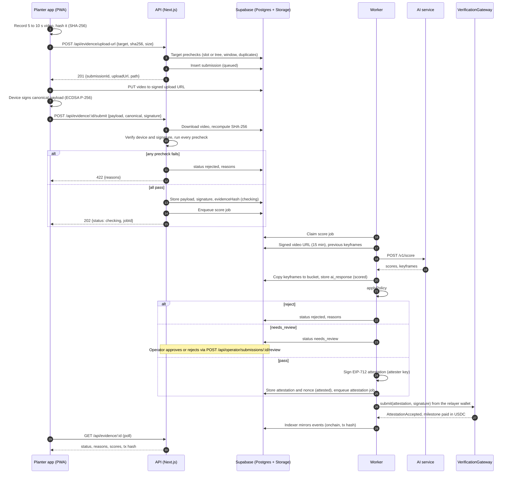

# Evidence pipeline

How a planter's video becomes an on-chain attestation. Rules come from `PRODUCT_KNOWLEDGE.md` sections 3, 5, 7, 8 and 15, and from `AI_SERVICE_INTERFACE.md`.

## Where the code lives

| Piece | Location |
|---|---|
| Prechecks (pure functions, one reason code each) | `apps/web/lib/server/precheck.ts` |
| Loading precheck facts, submission view | `apps/web/lib/server/evidence.ts` |
| Endpoints | `apps/web/app/api/evidence/*`, `apps/web/app/api/operator/submissions/[id]/review` |
| AI client (HTTP and mock) | `packages/pipeline/src/ai-client.ts` |
| Attester (EIP-712 signing) | `packages/pipeline/src/attester.ts`, wired to env in `apps/web/lib/server/attester.ts` |
| Score job: AI call, keyframes, policy, attest | `packages/pipeline/src/score.ts` |
| Attest step and attestation job | `packages/pipeline/src/attest.ts` |
| Policy | `packages/shared/src/policy.ts` |

`@treecord/pipeline` holds the server code that both the API and the worker need. The API uses the attester for operator approvals. The worker (prompt 9) runs `processScoreJob` for `score` jobs and relays `attestation` jobs.

## Why scoring runs in the worker

The AI service may take up to 60 seconds per call, a busy service is retried with backoff, and keyframes are copied afterwards. Together that can exceed the function duration limit of a Vercel deployment (the limit depends on the plan and configuration), and a request killed midway would leave a submission half done. Following decision 5 in `PRODUCT_KNOWLEDGE.md` section 15, submit runs only the fast checks and enqueues a `score` relayer job. The worker does the slow part, and the client polls `GET /api/evidence/:id`.

## Sequence



## Submission states

```
queued → uploaded → checking → scored → attested → onchain
                       │          ├──→ rejected
                       │          └──→ needs_review → attested (approved) | rejected (operator)
                       ├──→ rejected (prechecks, or AI says video_unreadable)
                       └──→ failed (AI returned 400, invalid answer, or stayed busy on the last attempt)
```

- `queued`: the row exists, waiting for the upload and the submit call.
- `uploaded`: a submit request has taken the submission and is checking it. Infrastructure errors hand it back to `queued` so the planter can retry.
- `checking`: prechecks passed, the `score` job is queued.
- `scored`: the AI response and keyframes are stored. A retried job resumes here without calling the AI again.
- `attested`: the attestation is signed and the `attestation` job is queued.
- `onchain`: the indexer saw `AttestationAccepted` with the submission's nonce. `tx_hash` is set when the relayer sends the transaction and confirmed by the event.
- `failed` after `attested`: the relayer gave up on the attestation (a permanent revert such as `MilestoneAlreadySettled`, or every attempt used). `error` says why. If the attestation lands anyway, the indexer still moves it to `onchain`.

`passed` exists in the enum but is not used: a passing submission is signed in the same step.

## Prechecks

All prechecks run at submit. The target-level ones also run at upload-url, so a planter never uploads a video that cannot be accepted. Every failing reason is returned, not just the first. The reason codes are listed in [api.md](api.md#evidence).

| Check | Rule | Source of the facts |
|---|---|---|
| Device | Registered by thumbprint, not revoked, owned by the submitter | `devices` |
| Signature | ECDSA P-256 over the canonical bytes, P1363, base64url | device JWK |
| Hash | SHA-256 of the stored file equals `videoSha256` | Storage download |
| Capture time | At most 72 h old, at most 5 min in the future | payload, server clock |
| GPS | `acc` ≤ 30 m | payload |
| Location | PLANTED inside the campaign radius. Later kinds within 15 m of the first location (`trees.exact_lat/lon`, or the planting submission's payload until the indexer fills it) | `campaigns`, `trees`, `submissions` |
| Duplicate | A video hash is used once. An upload retry by the same owner for the same queued target is not a duplicate (decision 8) | `submissions.video_sha256` (unique) |
| Milestone window | ALIVE only: chain time in `[plantedAt + paused + due × unit, + unit]`, the same rule as `Campaign._window` | `trees`, `campaigns.time_unit_seconds`, latest block |
| Already done | ALIVE: payout mirrored or another accepted check-in. PLANTED: slot already has a tree or an accepted planting | `milestone_payouts`, `slots`, `trees`, `submissions` |
| Ownership | PLANTED slot or tree belongs to the caller's wallet | `slots`, `trees` |
| Tree status | ALIVE and DEAD need `alive`, REPLANTED needs `dead` before the replant deadline | `trees` |
| Campaign status | PLANTED needs `active` | `campaigns` |
| Challenge | If an unexpired, unfulfilled challenge exists for the tree, the payload must carry its code | `challenges` |
| Duration | Recorder duration, when given, 4 to 12 s (decision 10) | upload-url request |

Two races are closed by the database rather than the prechecks: a second check-in for the same tree milestone (or a second planting for a slot) that passes scoring is refused by the partial unique indexes on `submissions` and rejected with `milestone_already_done`.

## Scoring and policy

The worker builds the AI request from the stored submission: a 15 minute signed URL for the video, the campaign species, the signed location and capture time, the payload's challenge code, and for non-PLANTED kinds the tree id, planting time and up to 6 signed keyframe URLs from the tree's earlier accepted submissions.

| AI outcome | Result |
|---|---|
| 200 | Keyframes copied to `keyframes/{submissionId}/{i}.jpg`, then `applyPolicy` |
| 422 | `rejected` with `video_unreadable` |
| 400 or malformed response | `failed` |
| 503 | Retried 3 times with backoff (1, 2, 4 s) inside the call. Still busy, 5xx, network error or timeout: the job throws and the queue retries it. On the job's last attempt the submission becomes `failed` |

The policy (`packages/shared/src/policy.ts`) decides `pass`, `needs_review` or `reject` and the 0 to 10000 attestation score. The challenge counts as issued only when the submission matched an active challenge.

### Mock AI

With `MOCK_AI=true` the worker uses `MockAiClient`: passing scores and one placeholder keyframe. The payload's `challenge` field selects deterministic outcomes for tests and demos:

| Challenge | Outcome |
|---|---|
| `FAIL-LIVENESS`, `FAIL-RECAPTURE`, `FAIL-PRESENCE`, `FAIL-DUPLICATE`, `FAIL-GROWTH` | reject |
| `REVIEW-LIVENESS`, `MISSING-GROWTH` | needs_review |
| `UNREADABLE` | AI 422 → `video_unreadable` |
| `BUSY` | AI 503 (retryable) |
| `BAD-INPUT` | AI 400 → `failed` |

## Attestation

| Field | Value |
|---|---|
| `kind` | PLANTED 0, ALIVE 1, DEAD 2, REPLANTED 3 |
| `slotId`, `treeId` | slot for PLANTED (tree 0), tree for the rest (slot 0) |
| `planter` | the submitter's wallet |
| `evidenceHash` | `keccak256(canonicalBytes ‖ signatureBytes)` |
| `geohash` | precision-7 geohash of the signed location as `bytes8`. Exact GPS never goes on-chain |
| `score` | policy score |
| `nonce` | random uint256, stored in `submissions.attestation_nonce` (unique) |
| `expiry` | chain time + 1 hour |

The signed record (attestation, signature, EIP-712 digest, signer, chain id, gateway) is stored in `submissions.attestation`. The `attestation` relayer job has payload `{ submissionId, nonce, attestation, signature }` and idempotency key `attestation:<submissionId>`, so a retried step never queues it twice.

### Relaying and expiry

The worker relays attestation jobs as described in [worker.md](worker.md#relayer). If an attestation is within 30 seconds of its expiry before it was sent (for example after a long queue or an outage), the worker signs it again with a fresh nonce and expiry and updates both the submission and the job. An expired attestation can never be accepted, so the replacement cannot double up. A simulation that reverts with `NonceAlreadyUsed` means the attestation is already on-chain, so the job is confirmed without sending.

## Testing

- `apps/web/test/precheck.test.ts`: every precheck reason, including boundaries.
- `packages/pipeline/src/ai-client.test.ts`: retries, backoff, timeouts, error mapping, mock hooks.
- `packages/pipeline/src/attester.test.ts`: signatures recover to the attester and match `hashAttestation`.
- `apps/web/test/api/evidence.test.ts`: the full flow against local Supabase (database and storage). It uploads a real file, submits a payload signed by a WebCrypto device key, runs the score job with the mock, and checks that the queued attestation verifies against `hashAttestation` and recovers to the attester address.
- `apps/worker/src/test/e2e.test.ts`: the worker scores a planting with the mock, relays the attestation to contracts on anvil, and the indexer mirrors the tree, the milestone 0 payout and the `onchain` status.
