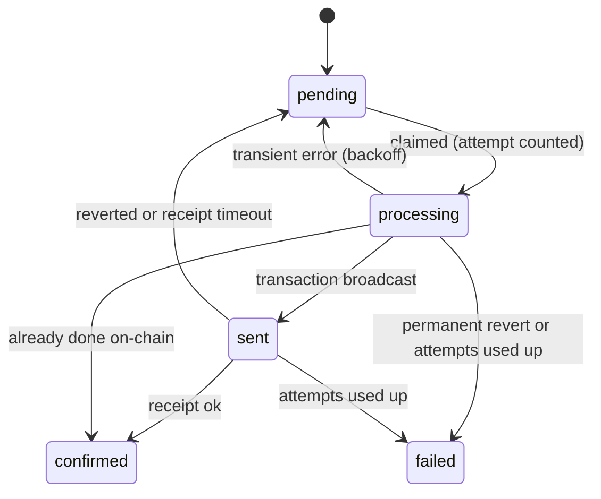

# Treecord worker

`apps/worker` is one Node process with three jobs:

- **Indexer:** mirrors contract events into Supabase.
- **Relayer:** works through `relayer_jobs`. It scores evidence and sends transactions from the backend wallets, so planters never pay gas.
- **Scheduler:** once a minute it makes the maintenance calls the contracts leave to anyone (forfeits, expiries, completions).

The chain stays the source of truth. The worker only mirrors it, and it only acts through transactions the contracts verify.

## Code

| Path | What |
|---|---|
| `src/index.ts` | Entry point: env, clients, HTTP server, signal handling |
| `src/worker.ts` | Runs the loops and builds the health report |
| `src/indexer/decode.ts` | Raw logs to typed events, using the ABIs in `packages/shared` (pure) |
| `src/indexer/apply.ts` | One handler per event, writing the mirror tables |
| `src/indexer/indexer.ts` | Cursor, block ranges, campaign discovery |
| `src/relayer/relayer.ts` | Score, attestation and operator lanes |
| `src/relayer/calls.ts` | The contract call for each job kind |
| `src/relayer/state.ts` | Job state transitions and retry rules (pure) |
| `src/relayer/nonces.ts` | Local nonce tracking per wallet |
| `src/scheduler.ts` | Due maintenance calls (pure `dueTasks`) and their sending |
| `src/server.ts` | `GET /health` and `GET /metrics` |

## Running

### Locally against anvil

```sh
pnpm db:start                                         # Supabase
pnpm --filter @treecord/contracts anvil               # terminal 1 (mines a block every second)
pnpm --filter @treecord/contracts deploy:local        # contracts, writes deployments/31337.json
pnpm --filter @treecord/contracts export-abis         # refresh packages/shared addresses
pnpm --filter @treecord/worker dev                    # terminal 2
```

Copy `.env.anvil.example` to the root `.env`. It has the anvil keys, the local Supabase keys and `MOCK_AI=true`. anvil must mine on an interval (the package script passes `--block-time 1`): the indexer waits for 2 confirmations, and the API reads chain time from the latest block, which stands still on an idle automine chain.

### Railway

Build from the repo root with `apps/worker/Dockerfile` (in Railway, keep the root directory at the repo root and set the Dockerfile path). The image runs `node dist/index.js` as the `node` user and has a Docker health check on `/health`. Set the env vars below in the Railway service and point its health check at `/health`.

```sh
docker build -f apps/worker/Dockerfile -t treecord-worker .
docker run --env-file .env -p 8080:8080 treecord-worker
```

## Configuration

Required: `BASE_SEPOLIA_RPC_URL`, `CHAIN_ID`, `OPERATOR_PRIVATE_KEY`, `RELAYER_PRIVATE_KEY`, `ATTESTER_PRIVATE_KEY`, `SUPABASE_URL`, `SUPABASE_SERVICE_ROLE_KEY`, and either `MOCK_AI=true` or `AI_SERVICE_URL` plus `AI_SERVICE_TOKEN`. Contract addresses come from `packages/shared/src/addresses.ts` for `CHAIN_ID`.

| Variable | Default | Meaning |
|---|---|---|
| `WORKER_MODE` | `all` | `all`, `indexer` (mirror only) or `relayer` (jobs and scheduler only). Run two processes with different modes to scale them apart |
| `PORT` | `8080` | HTTP port for health and metrics. Railway sets it |
| `LOG_LEVEL` | `info` | pino level |
| `INDEXER_POLL_MS` | `4000` | Wait between cycles once caught up |
| `INDEXER_CHUNK_BLOCKS` | `2000` | New blocks per `eth_getLogs` call |
| `INDEXER_CONFIRMATIONS` | `2` | Only blocks this deep are indexed |
| `INDEXER_RESCAN_BLOCKS` | `5` | Already indexed blocks scanned again every cycle |
| `INDEXER_START_BLOCK` | deploy block | First block when there is no cursor yet |
| `RELAYER_POLL_MS` | `2000` | Wait between job polls when the queue is empty |
| `SCHEDULER_INTERVAL_MS` | `60000` | Maintenance pass interval |

## Health and metrics

`GET /health` returns 200 while every loop is healthy and 503 otherwise. A loop is unhealthy when it has failed before ever succeeding, or has not succeeded for ten of its intervals plus a minute. The body lists each loop's last success and last error, and the indexer's last block, head and lag.

`GET /metrics` returns JSON counters and gauges since start, for example `indexer.events.TreePlanted`, `indexer.lagBlocks`, `relayer.claim.confirmed`, `relayer.attestation.retried`, `relayer.score.attested`, `scheduler.forfeit`.

## Indexer

Each cycle:

1. Reads `chain_cursor` (row `indexer:<chainId>`). Without a row it starts at the deploy block.
2. Picks the range from 5 blocks before the next unindexed block up to 2000 new blocks, capped at `head - 2`. The overlap re-scans recent blocks, so logs that moved in a short reorg are picked up again.
3. Fetches `CampaignCreated` from the factory first and adds the new clones to the watched set. Then it fetches the logs of every watched contract (factory, registry, gateway, ledger and all campaigns) in one call, so a campaign's first contribution in the same range is not missed.
4. Decodes, sorts by block and log index, and applies each event.
5. Writes the cursor.

If the cursor is ahead of the chain head, the indexer logs a warning once and waits. On anvil this means the chain was restarted under an old database. Run `pnpm db:reset` rather than mixing two chains in one mirror.

Supabase's HTTP API has no multi-statement transactions, so the cursor cannot move in the same transaction as the writes. Instead every write is idempotent and the cursor moves last. A crash replays the chunk, and the replay ends in the same state:

- Event rows have `unique (tx_hash, log_index)` (or their natural key), and a duplicate insert is ignored.
- State columns take absolute values from the event: `totalRaised`, `checkInCount`, statuses, deadlines.
- Values the chain only reports as deltas are rebuilt from stored events: a tree's paused seconds and its restored status after a dismissed flag (from `tree_events`), carbon balances (allocations + purchases − retirements, minus sales for inventory), and allocated reservation amounts.

### Event mapping

| Contract | Event | Mirror |
|---|---|---|
| CampaignFactory | `CampaignCreated` | `campaigns` row from the config. Title, description, region name and center come from `campaign_metadata` when the `metadataURI` ends in its id. Otherwise the region center is the center of the on-chain geohash cell. `species_name` from `species`, `creator_profile_id` by wallet |
| Campaign | `Contributed` | `contributions`, `campaigns.funded_amount` |
| | `Activated`, `RefundingStarted`, `CampaignCompleted` | `campaigns.status` plus incentive pool, per-tree incentive, reserve, refund pool, timestamps |
| | `Refunded` | `refunds` |
| | `SlotsClaimed`, `AnchorSlotsAssigned` | `slots` rows (`claimed`). Kind is `anchor` for ids up to `anchor_slots`, else `open` (rolled-over open slots keep `open`) |
| | `SlotPlanted` | `slots.status = planted`, `slots.tree_id` |
| | `MilestonePaid`, `MilestoneForfeited` | `milestone_payouts`, `milestone_forfeits` |
| TreeRegistry | `TreePlanted` | `trees`, with `exact_lat/lon` from the PLANTED submission with the same evidence hash. `tree_events` planted |
| | `CheckInRecorded` | `trees.check_in_count`, `latest_evidence_hash`, `tree_events` |
| | `TreeDied`, `TreeReplanted`, `TreeRemoved`, `TreeCompleted` | `trees.status`, replant deadline, `tree_events` |
| | `TreeFlagged` | `trees.status = flagged`, `tree_events` (with the status before the flag). Links the oldest `pending` flag with the same tree and reason hash (`open`). A flag sent without the API gets its own row |
| | `FlagResolved` | `flags` upheld or dismissed. On dismissal the tree's status, paused seconds and replant deadline are rebuilt like `TreeRegistry.resolveFlag` |
| VerificationGateway | `AttestationAccepted` | Submission with that nonce becomes `onchain` with the tx hash. Its attestation job is confirmed if the relayer has not done so |
| CarbonLedger | `EstimateSet`, `Reserved`, `ReservationDeclined` | `campaigns.estimated_amount`, `carbon_reservations` |
| | `BatchIssued`, `PriceSet` | `carbon_batches` |
| | `Allocated`, `Purchased`, `Retired` | `carbon_allocations`, `carbon_purchases`, `retirements`, then `carbon_balances` and `carbon_reservations.allocated_amount` |

`BucketsReleased`, `ReserveDrawn`, `Initialized` and the ERC-1155 transfer events carry nothing the mirror needs.

## Relayer

Three lanes poll the queue side by side. Each claims due jobs with `claim_relayer_jobs` (`FOR UPDATE SKIP LOCKED`), so several workers can run at once.

| Lane | Kinds | Wallet | Contract call |
|---|---|---|---|
| score | `score` | none | `processScoreJob` from `@treecord/pipeline` (see [evidence-pipeline.md](evidence-pipeline.md)) |
| attestation | `attestation` | relayer | `VerificationGateway.submit`, or `submitBatch` for up to 10 |
| operator | `claim`, `anchor_assign`, `estimate`, `issue`, `set_price`, `resolve_flag` | operator (holds `OPERATOR_ROLE` and `ISSUER_ROLE`) | `Campaign.claimSlotsFor`, `Campaign.assignAnchorSlots`, `CarbonLedger.setEstimate`, `CarbonLedger.issueBatch`, `CarbonLedger.setPrice`, `TreeRegistry.resolveFlag` |

The attester key only signs. It never sends a transaction.

### Job payloads

Schemas live in `packages/shared/src/jobs.ts`. uint256 values are decimal strings.

| Kind | Payload |
|---|---|
| `score` | `{ submissionId }` |
| `attestation` | `{ submissionId, nonce, attestation, signature }` |
| `claim`, `anchor_assign` | `{ campaign, planter, count }` |
| `estimate` | `{ campaign, estimatedAmount }` in carbon units (1000 = 1 tCO2e) |
| `issue` | `{ campaign, registry, serialStart, serialEnd, vintage, amount }` |
| `set_price` | `{ batchId, usdcPerTonne }` |
| `resolve_flag` | `{ treeId, uphold, noteHash }` |

A payload that fails its schema fails the job at once.

### Sending

1. If the job already has a tx hash from an earlier attempt, the worker checks it first. If it is mined and succeeded, the job is confirmed. If it is still pending, the worker waits. If it reverted or vanished, the job is sent again.
2. Simulates the call from the sending wallet. Attestations are simulated one by one, and only those that pass go into the batch. `submitBatch` is all or nothing, so one bad attestation can never sink the others.
3. Sends with a nonce from the local nonce manager. Sends per wallet are serialized. A failed send makes the next one re-read the pending nonce from the chain, which closes the gap.
4. Marks the job `sent` with the tx hash (and the submission's `tx_hash` for attestations), then waits up to 90 seconds for the receipt.



### Retries

Each claim counts as an attempt (`max_attempts` 5). Failed attempts wait 15 s, 30 s, 60 s, 120 s and so on, capped at 10 minutes. A revert that retrying cannot fix fails the job at once: for example `PlanterCapExceeded`, `NotEnoughSlots`, `ClaimWindowClosed`, `MilestoneAlreadySettled`, `SlotNotOwned`, `EstimateLocked`, `InvalidAttester`. The full list is `PERMANENT_REVERTS` in `state.ts`. Windows that are not open yet, flagged trees, RPC errors and unknown reverts are retried. Nested reverts (for example `MilestoneNotOpen` from inside the gateway) are decoded with the errors of every Treecord ABI.

Special cases for attestations:

- `NonceAlreadyUsed` means it is already on-chain, so the job is confirmed without sending.
- Within 30 seconds of expiry, or after an `AttestationExpired` revert, the attestation is signed again with a new nonce (see [evidence-pipeline.md](evidence-pipeline.md#relaying-and-expiry)).
- A job that fails for good moves its submission from `attested` to `failed` with the error.

A worker that dies mid-job leaves it `processing` or `sent`. `claim_relayer_jobs` reclaims such jobs after 5 minutes, and step 1 above prevents a double send.

## Scheduler

Once a minute, from the mirror and chain time:

| Call | When |
|---|---|
| `Campaign.forfeitMilestone(tree, m)` | Tree Alive or Dead, milestone window closed (`now > closesAt`, shifted by paused seconds), milestone neither paid nor forfeited |
| `TreeRegistry.expireDead(tree)` | Tree Dead and `now > replantDeadline` |
| `TreeRegistry.markCompleted(tree)` | Tree Alive and all six milestones settled |
| `Campaign.complete()` | Campaign Active, every planted tree Completed or Removed, and the commitment period plus the final window has passed since the later of the last planting and the claim deadline |

Flagged trees are skipped because flags freeze the clock. Each call is simulated first. A call that would revert (the mirror is a few blocks behind, for example) is skipped and not tried again for 10 minutes. Up to 25 calls are sent back to back with consecutive nonces, and their receipts are awaited together. The indexer then mirrors the resulting events.

## Testing

```sh
pnpm --filter @treecord/worker test       # unit tests (also part of pnpm test)
pnpm --filter @treecord/worker test:e2e   # end-to-end, needs Foundry, built contracts and pnpm db:start
```

The end-to-end test runs a live worker, and a live worker claims every due job in the local database, including jobs the web route tests create. It is therefore a separate command and not part of `pnpm test`, where the web tests run in parallel. It does relay leftover jobs from earlier web test runs, which fail harmlessly against the fresh anvil contracts.

- `src/indexer/decode.test.ts`: events encoded the way the contracts emit them decode to the right typed events, unknown addresses and events are ignored, ordering. Also the metadata id parser and the flag dismissal rebuild.
- `src/relayer/state.test.ts`: backoff, revert classification, and every job transition.
- `src/relayer/nonces.test.ts`: local nonce counting, serialization, recovery after a failed send.
- `src/scheduler.test.ts`: due forfeits, expiries and completions at their exact boundaries, and the indexer's block ranges.
- `src/test/e2e.test.ts`: starts anvil, deploys the contracts like `Deploy.s.sol`, and runs the whole worker against local Supabase. A donor contribution activates a campaign, a `claim` job assigns a slot through the operator wallet, and a planting goes through `score` (mock AI) and `attestation` to the chain. The test checks the campaign, contribution, slot, tree (with exact GPS), milestone 0 payout, submission `onchain` and both jobs `confirmed` in Supabase. It then moves anvil time past milestone 1's window and checks that one scheduler pass forfeits it and the forfeit is mirrored. It skips with a warning when one of its requirements is missing, and removes what it created when it finishes.
